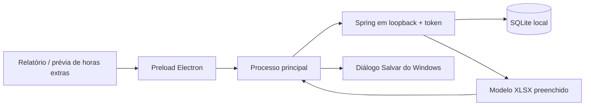

# Atualização do Foco-Web para o Foco-Java 1.19.0

Solicitada em 04/11/2026, no sentido **Foco-Web → Foco-Java**. A origem inclui o commit `d32cbc9` e as alterações locais existentes no Web nessa data. O projeto Foco-Web permanece inalterado.

## Recursos incorporados

- Meu dia em Kanban: tarefas para hoje, priorizadas e feitas, com reabertura de tarefas.
- Lista de tarefas com ações compactas, estimativa opcional, filtros e sugestões de consultor por cliente/projeto.
- Projetos vinculados a clientes, cores persistentes e cores próprias dos projetos.
- Apontamentos criam uma tarefa quando necessário; concluir o apontamento conclui a tarefa vinculada. Retroativos criam tarefas concluídas sem modificar o estado de tarefas já existentes.
- Relatórios ordenados pelo instante real, inclusive entre fusos, e linha do tempo no Dashboard.
- Preferência persistente por horas reais/arredondadas, cinco paletas e configurações organizadas em abas.
- Folgas retroativas e exportação XLSX de horas extras entre meses/anos, com prévia, tolerância diária, abatimentos e dados do prestador.

## Adaptação desktop

A interface continua chamando o backend exclusivamente pelo preload Electron. O backend permanece em loopback com token local. O cronômetro mantém o ciclo de gravação local e pausa após reinício. Hospedagem, autenticação Web, armazenamento em nuvem e cronômetro de servidor não fazem parte desta adaptação.

Captura global, caixa de entrada, modelos recorrentes, capacidade de planejamento, revisão de capturas, bandeja, sobreposição, importação V35, logs, backup e restauração locais permanecem disponíveis. A exportação XLSX usa um canal IPC específico, busca somente a rota local de exportação e grava os bytes no destino escolhido pelo usuário. Cancelar o diálogo não grava arquivo; erros da API ou do disco são apresentados na interface.

## Dados e compatibilidade

A tabela adicional `project_clients` relaciona chaves de projetos e clientes. A reconciliação recupera vínculos existentes em tarefas e sessões, sem reescrever seus dados históricos. Estimativas usam `task_estimates`; preferências continuam em `settings`. As novas regras de criação e conclusão são transacionais. Os testes importados cobrem rollback, restauração, migração idempotente de vínculos e preservação de cores personalizadas.

A integração inicial de 04/11 não modificou banco real nem instalação. Em 06/11 a Stable 1.19.0 foi gerada e instalada localmente. Na mesma sessão, o usuário forneceu o banco de outro computador e autorizou sua transferência: 138 tarefas e 431 apontamentos preservados, com backup do banco anterior e original recebido mantido. Detalhes em [Instalação](Instalacao.md).

## Validação

Em 06/11, a compilação Java funcionou com o ambiente atual, sem alteração de dependências: 154 testes Java e 224 testes Vitest passaram. A execução original de `npm test` foi interrompida pelo reinício do servidor após concluir o backend; a suíte desktop foi executada novamente até o fim.

A conferência Electron gerou 28 capturas com dados simulados em janelas de 1440 × 960 e 800 × 620, sem erros JavaScript ou transbordamento horizontal após os ajustes de layout. Apontar horas passa a empilhar formulário e cronômetro até 1000 px, e as paletas usam três colunas nessa largura. A inspeção visual é complementar aos testes, não uma validação de todas as operações reais.

Evidências atuais: `.atualizacao_status/1.19-*`; evidências da integração inicial: `.atualizacao_status/web-port-*`. Os registros de empacotamento, instalação e preservação do banco estão em [Instalação](Instalacao.md).
