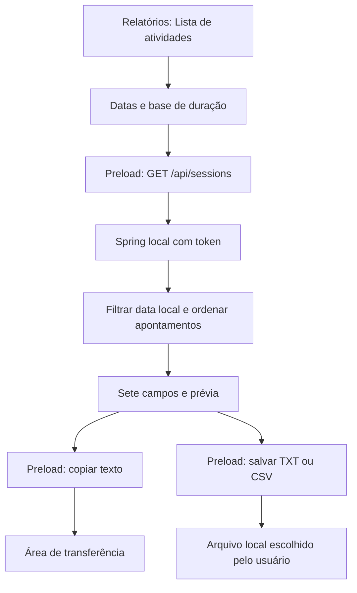

# Lista de atividades — New 1.21.0

## Uso

1. Abra **Relatórios → Lista de atividades**.
2. Confira as datas inicial e final. Ao abrir, as duas datas correspondem ao dia atual.
3. Para consultar outro período, altere as datas e selecione **Atualizar lista**. As duas datas entram no período.
4. Escolha **Horas reais** ou **Horas arredondadas** em **Duração da lista**. A opção inicial segue a preferência de horas do aplicativo.
5. Confira a prévia. Use **Copiar lista**, **Exportar TXT** ou **Exportar CSV simples**.

A cópia e o TXT usam uma linha por apontamento, com os campos nesta ordem:

```text
17/11/2026
Hora início - Duração - Hora fim - Cliente - Projeto - Detalhamento - Consultor solicitante
09:00 - 01:00:00 - 10:00 - Cliente - Projeto - Ajustar integração - Maria
```

O TXT e a cópia agrupam as linhas por data. O CSV mantém sete colunas na mesma ordem. Em períodos com mais de um dia, a coluna Hora início também contém a data. O nome do arquivo identifica o período.

## Regras

- A consulta considera a **data local de início** de cada apontamento e ordena pelo instante de início. Os filtros e as seleções do relatório principal não alteram esta lista.
- Cada apontamento aparece uma vez. Uma atividade que termina no dia seguinte permanece no dia de início. Nesse caso, o campo Hora fim também mostra a data do término.
- A duração usa horas, minutos e segundos (`HH:mm:ss`), com a base escolhida. Usa o tempo de foco salvo, que exclui pausas. A diferença entre os horários de início e fim pode ser maior que a duração.
- Hora fim usa o término real. Atividades abertas mostram **Em andamento** ou **Pausada**, com a duração registrada na última consulta. Use **Atualizar lista** para obter os dados mais recentes.
- Registros antigos sem precisão recuperável mantêm a duração salva. A tela informa essa condição.
- Detalhamento usa o campo do apontamento. Se o campo estiver vazio, usa o nome da atividade. Outros campos vazios mostram `—`.
- Quebras de linha e tabulações dentro dos campos viram espaços. Os acentos são preservados.
- Lacunas **A definir** não entram. Tarefas sem apontamentos também não entram.
- Ao mudar as datas, a prévia anterior é removida. A cópia e a exportação ficam bloqueadas até concluir uma consulta válida com resultados.
- Uma resposta antiga não substitui uma consulta mais recente. Erros de leitura, cópia e gravação aparecem na tela. Cancelar a escolha do arquivo não gera uma mensagem de sucesso.

## Fluxo técnico

`ActivityListDialog` consulta `GET /api/sessions` pelo preload. O renderer filtra os registros pela data local. Isso evita comparar apenas o prefixo de data de registros UTC ou com outros deslocamentos de fuso.

`activityList.ts` monta as sete células. `focusSeconds` aplica a regra já usada no aplicativo para horas reais e arredondadas. A mesma lista gera a prévia, a cópia, o TXT e o CSV. O CSV usa `csvCell` para escapar aspas e proteger células que começam com sinais de fórmula. O arquivo usa ponto e vírgula, UTF-8 com BOM e finais de linha CRLF. O TXT usa UTF-8 e CRLF.

`activity-export.cjs` registra os canais `foco:copy-text` e `foco:save-text`. O primeiro grava texto pela API de área de transferência do Electron. O segundo abre o diálogo local de gravação e salva no caminho escolhido. Ambos validam o conteúdo, com limite de 25 MiB em UTF-8. A exportação CSV usa o canal existente `foco:save-csv`.

O Spring permanece em loopback e exige o token local. Não há chamada de rede no renderer nem envio para serviços externos.



## Entidades

Não há migração nem nova tabela. A consulta lê `Session`: `startAt`, `endAt`, `roundedEndAt`, `focusSeconds`, `client`, `project`, `details`, `activity`, `consultant` e `status`.

`ActivityRange` contém as duas datas. `ActivityLine` contém a data local e as sete células. Esses objetos existem apenas na memória da tela. A exportação não altera tarefas, apontamentos, horas ou dados do consultor.

## Validação

Os testes Vitest cobrem ordem dos campos, duração sem pausas, horas reais/arredondadas, limites de data, UTC, virada de dia/ano, registros abertos e antigos, campos vazios, acentos, aspas, CSV, atualização, consultas concorrentes, erros, cancelamento e integração do preload com a cópia e a gravação de TXT.

`npm test` passou com 158 testes Java e 268 testes Vitest. `npm run build` gerou `release/New/Foco-New-Setup-1.21.0.exe`. Os 14 arquivos desktop do pacote correspondem aos arquivos compilados. O JAR e o hash do manifesto também foram conferidos.

A conferência visual usou dados de teste e o preload compilado, nos temas claro/escuro e nas janelas de 1440 × 960 e 800 × 620. A cópia e os arquivos foram comparados com a prévia. O teclado alcançou os botões na janela compacta. A versão instalada não foi alterada.

Evidências locais: `.atualizacao_status/activity-list-tests.log`, `activity-list-build.log`, `activity-list-package.json` e `activity-list-qa/`. O resultado da limpeza está em [Limpeza](Limpeza.md).
