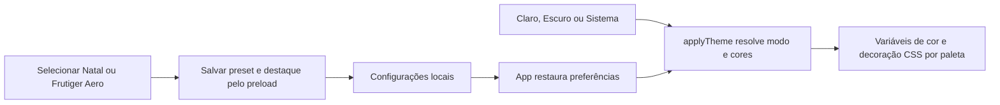

# Temas especiais — New 1.20.0

Em **Configurações → Aparência → Temas**, Natal e Frutiger Aero complementam as cinco paletas existentes. Natal combina verde pinheiro, vermelho, creme e detalhes dourados. Frutiger Aero usa azul, verde, superfícies com aparência de vidro e botões brilhantes. Cada cartão apresenta uma prévia. Selecionar um tema aplica sua cor de destaque; o usuário pode personalizá-la depois.

Os dois temas respeitam Claro, Escuro e Seguir sistema. A escolha é mantida ao reabrir o aplicativo. Trocar de tema não altera cores cadastradas de clientes/projetos, apontamentos ou outros dados. Não há animações novas, fontes remotas ou imagens externas. As decorações são feitas em CSS e não cobrem controles. A impressão remove fundos decorativos e sombras.

## Fluxo e entidades

`themePresets` adiciona os identificadores `christmas` e `aero`. A entidade local de configurações continua usando `theme.preset`, `theme` e `accent`; nenhuma migração é necessária. `SettingsPage` salva pelo fluxo existente de `onChange`, preload Electron e Spring autenticado em loopback. `App` restaura as preferências e acompanha mudanças do modo do sistema. `applyTheme` aplica as paletas claro/escuro e expõe `data-appearance` com o modo resolvido. `specialThemes.css` limita os efeitos a `data-palette`, permitindo trocar para qualquer paleta anterior sem resíduos.

## Validação

Vitest cobre seleção e restauração dos identificadores, preservação do modo, mudança do sistema, destaque personalizado, retorno à paleta clássica e contraste de texto nas sete paletas. A conferência visual usa dados simulados locais; instalação e preservação de dados são registradas em [Instalação](Instalacao.md).

## Corre??o de persist?ncia ? 11/11/2026

O servidor local rejeitava `christmas` e `aero`. A lista de op??es aceitas agora inclui os dois identificadores. O teste Java verifica grava??o, leitura posterior, preserva??o do modo e da cor, e rejei??o de op??es inv?lidas sem alterar as prefer?ncias.

Valida??o da corre??o: `npm test` aprovado (155 Java e 237 Vitest); `npm run build` aprovado. Instalador New 1.20.0 gerado localmente. A vers?o instalada n?o foi alterada nesta etapa.
