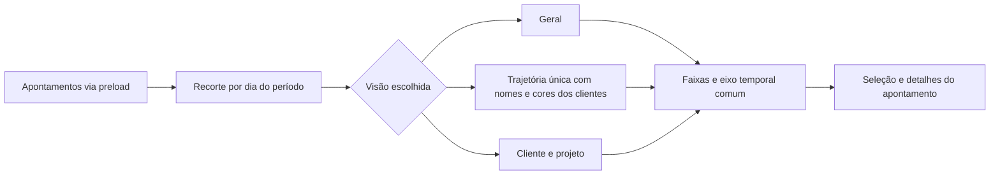
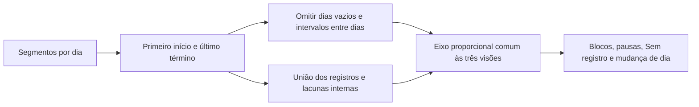

# Linha do tempo por cliente e projeto

No Dashboard, a Linha do tempo oferece três visões: **Geral** (padrão), **Por cliente** e **Por projeto**. Por cliente transforma a linha existente em uma trajetória cronológica: cada bloco mostra o nome e a cor do cliente, permitindo acompanhar sequências como Cliente A → Cliente B → Cliente A. Projetos diferentes do mesmo cliente usam a mesma cor nessa visão. Por projeto mantém faixas separadas pelo par cliente/projeto, para separar nomes iguais em clientes diferentes. Valores vazios aparecem como “Sem cliente” e “Sem projeto”; clientes vazios usam uma cor neutra. Só aparecem intervalos do período.

A escolha de visão mantém a data, a escala Dia/Semana/Mês e o apontamento selecionado. Os totais continuam sendo de todo o período. Cores, pausas hachuradas, períodos estimados, intervalos sobrepostos e detalhes dos apontamentos são preservados. A visão vale enquanto o componente estiver montado; não altera os filtros dos gráficos.

## Implementação e entidades

`DashboardTimeline` usa os apontamentos já carregados pelo preload Electron e recortados por `timelineSegments`. `timelineGroups` em `dashboardTimeline.ts` mantém um grupo único em Geral e Por cliente, e agrupa pelo par `Session.client`/`Session.project` em Por projeto. Cada grupo ordena os intervalos e aloca faixas adicionais somente para sobreposições reais. Não há fusão de intervalos: retornos ao mesmo cliente, pausas e lacunas preservam seus horários e seleção individual. O componente usa `clientColor` em Por cliente e cores de projeto nas demais visões. As coordenadas horizontais usam a mesma escala compactada em todos os grupos.

Nenhuma entidade persistida, migração ou rota foi adicionada. O agrupamento usa a classificação do apontamento, preservando a leitura do histórico mesmo sem catálogo ativo. Spring continua acessível somente pelo preload, em loopback e com token local.

## Cobertura

`DashboardTimeline.test.tsx` verifica agrupamentos, projetos homônimos, nomes vazios, sobreposições, preservação da quantidade e duração dos intervalos e alternância das visões mantendo seleção, escala, data e totais, sem outra consulta ao backend.

Validação final em 06/11/2026: `npm test` aprovado (154 Java e 226 Vitest) e `npm run build` concluído, gerando novamente o instalador local New 1.19.0. Conferência Electron com dados simulados: 12 capturas, três visões em 1440 × 960 e 800 × 620, temas claro/escuro, sem erros JavaScript ou transbordamento da página. Evidências em `.atualizacao_status/timeline-groups-*`. Não houve instalação nem publicação.

Limpeza: removidos o perfil temporário da conferência visual e a pasta intermediária `release/New/win-unpacked`; preservados instaladores, backups, fontes e evidências. Manifesto SHA-256 local de New atualizado após a geração.

## Alteração de 10/11/2026

Por cliente passa a transformar a linha existente em uma trajetória cronológica. A visão Por projeto permanece agrupada. Sem alteração de entidades, banco ou comunicação com Spring. A cobertura adicionada verifica sequência A → B → A em uma faixa, cores independentes de projeto, lacunas, cliente vazio, seleção de detalhes e retorno à visão Geral.

Validação: `npm test` aprovado com 154 testes Java e 227 Vitest; `npm run build` concluído com instalador local New 1.19.0 atualizado. Logs em `.atualizacao_status/timeline-trajectory-tests.log` e `timeline-trajectory-build.log`. Removida a pasta intermediária `release/New/win-unpacked` e atualizado o manifesto SHA-256. Instaladores anteriores e backups preservados. Esta alteração não foi instalada nem publicada.

## Faixa trabalhada — 11/11/2026

No Dashboard, cada dia ocupa somente o intervalo da primeira à última atividade registrada. Semana e mês concatenam essas faixas, omitindo dias vazios e o tempo entre o último registro de um dia e o primeiro do próximo. Uma linha tracejada marca a mudança de dia; o eixo informa a data e os horários inicial/final. Dentro do mesmo dia, nenhuma lacuna é comprimida, mesmo que longa: aparece como “Sem registro”. Pausas registradas continuam hachuradas. A largura é proporcional ao tempo exibido, incluindo intervalos internos, e não apenas ao foco.

`timelineScale` deriva janelas transitórias `{day, start, end, offset, gaps}` dos segmentos de cada dia. Calcula a união da cobertura para identificar lacunas sem criar falsos intervalos em sobreposições. A posição soma as durações das janelas anteriores ao deslocamento dentro da janela atual. Geral, Por cliente e Por projeto compartilham esse eixo; uma ausência em um projeto não é classificada como lacuna se outro tem registro naquele horário. Os totais, detalhes, seleção, estimativas e limites provisórios das sessões abertas continuam usando os segmentos originais. Trabalho que atravessa meia-noite continua recortado por dia, sem perder duração. Nenhuma entidade persistida ou API mudou.

Cobertura adicional: limites do eixo nas três visões, proporção das pausas, lacunas internas, dias vazios, compressão entre jornadas e período sem registros.

## Divis?o di?ria por hora ? 11/11/2026

Na escala Dia, as tr?s vis?es marcam cada hora cheia entre a primeira e a ?ltima atividade. Os limites reais continuam vis?veis: por exemplo, 09:15, 10:00, 11:00 e 11:20. Semana e M?s mant?m a escala anterior. A largura do eixo cresce com o n?mero de marcas e permite rolagem horizontal.

Fluxo: `timelineScale` calcula a faixa registrada ? `hourlyTimelineTicks` inclui limites e horas cheias ? `DashboardTimeline` posiciona as marcas na escala proporcional. N?o h? altera??o de entidades ou de dados. Vitest cobre horas inteiras, limites parciais, per?odos curtos e um dia completo.
